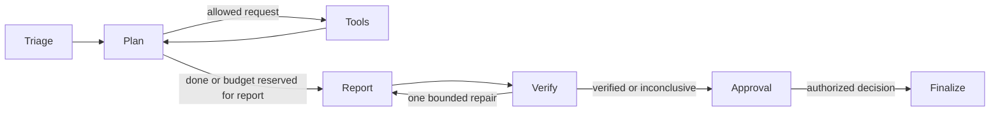

# Investigation agent design

Phase 0 proposal · 14 November 2026

The [Phase 4 runtime guide](AGENT_RUNTIME.md) describes the implemented graph and local verification.

## Graph and tool boundary

See the [implemented Phase 3 contracts and retrieval results](INVESTIGATION_TOOLS.md).

Use a LangGraph `StateGraph` with Pydantic models at tool, provider and API boundaries. The initial state contains investigation ID, scoped transaction reference, immutable cutoff, score and signed feature contributions, versioned configuration, and remaining budget. Triage chooses a small initial evidence set. The model proposes additional tool calls or ends the loop. The orchestrator validates arguments and executes from a fixed registry. Each call binds workspace, transaction and cutoff server-side. Cap rows and bytes before serializing observations. [LangGraph checkpointers](https://docs.langchain.com/oss/python/langgraph/checkpointers)

| Tool | Typed observation |
| --- | --- |
| `get_transaction` | Focal transaction and available payment fields |
| `get_customer_profile` | Observable synthetic profile and history availability |
| `get_customer_history(window)` | Bounded prior attempts, summary statistics and a truncation indicator |
| `velocity_check` | Named windows, attempt and decline counts, sums, and comparison to observed baseline |
| `geo_mismatch_check` | Distance and elapsed time between reliable points, location source and missingness |
| `device_check` | Prior device usage and first observed time, scoped to the case cutoff |
| `merchant_risk_lookup` | Observable risk tier and prior merchant patterns with sample size |
| `search_policy_docs` | Ranked policy excerpts with section, corpus version and content hash |

Persist one immutable observation per logical call under a stable evidence ID derived from the investigation and call sequence. Identical retries reuse the observation. Reject conflicting input for the same sequence. Failed and unavailable tool results are typed and can support an explicit data-gap claim. Read tools use a restricted DB role and fixed parameterized queries. The graph executor records investigation artifacts through its own application role. Tools expose no arbitrary SQL, URLs, payment operations, or disposition functions.

## Policy corpus

Start with 12 short synthetic playbooks covering decision criteria, escalation, takeover, card testing, velocity, travel, new devices, high-value purchases, cash-out, merchant collusion, insufficient evidence, and audit notes. Give each section a stable ID and version. Rank short sections with in-process BM25 and a small versioned alias list for phrases such as “card probing” and “card testing.” Return up to three relevant excerpts with a deterministic tie-break and a no-match result for weak queries. Measure top-three hit rate on an independently written set of policy queries before adding embeddings. Retrieved content is evidence data. The tool registry and budget rules are set by the server.

## Structured report and evidence check

Use a strict report schema with verdict `fraud | legit | needs_human_review`, self-reported confidence in [0, 1], action `block | release | escalate`, and a bounded list of typed claims. The confidence is the model's assessment. Each factual claim carries a claim kind, evidence ID, named observation field, comparator or exact value, and unit when applicable. Policy claims cite a retrieved section and its exact version. The verifier checks run ownership, result type, field, value, unit and cutoff. Cite supporting and conflicting evidence where relevant. Render factual summaries from verified fields and templates so an uncited narrative cannot introduce extra claims.

Enforce compatible verdict and action pairs, and require evidence that meets the demo's explicit policy prerequisites before showing a block or release recommendation. Keep minimum evidence requirements in a versioned decision rubric available across evaluation arms. Retrieved policies provide scenario-specific guidance. A report that cites a policy must cite an observed excerpt. Send validation errors or failed checks through one repair attempt within the shared budget. If it fails, publish a server-generated `needs_human_review` / `escalate` report with available verified facts and a failure reason. Test wrong values, unit mismatches, stale or foreign evidence IDs, unavailable retrieval, prompt injection in observation text and retry exhaustion.

## Provider adapter and budget

Start with Groq `AsyncGroq` and optional Gemini `google-genai` async client disabled by default until quota is confirmed. Use separate requests for tool planning and final structured synthesis. Groq's strict JSON schema output does not combine with tool calling or provider streaming. Gemini supports a subset of JSON Schema, so validate both providers' output with the same application schema. [Groq SDK](https://github.com/groq/groq-python) · [Groq structured outputs](https://console.groq.com/docs/structured-outputs) · [Google Gen AI SDK](https://github.com/googleapis/python-genai) · [Gemini structured outputs](https://aistudio.google.com/docs/structured-output)

Proposed starting caps are six planning rounds, eight tool calls, 6,000 aggregate provider tokens including retries, 90 seconds elapsed, and one repair. Reserve tokens and time for synthesis before planning. Estimate input conservatively, cap completion tokens including provider reasoning where supported, reconcile reported usage, and charge a reservation when consumption is unknown. Set deployed mode to free-tier credentials. Gate starts per IP and workspace, reserve from a global daily token budget, and check an operator kill switch before provider calls. When quota runs out, serve a labeled recording matched to the shared fixture. Report replay unavailability when no matching recording exists. Record estimated equivalent list-price cost separately from the billed amount. Retry transient errors and 429s within the same budget with jitter and `Retry-After`. A single retry owner prevents SDK and adapter retries from multiplying.

Use a bounded on-disk SQLite cache keyed by canonical request, provider/model, sampling parameters, prompt and schema versions, plus input evidence and corpus hashes. Store successful responses and usage with atomic writes. Use a mounted local volume and a cache-only evaluation mode that surfaces misses. Render's ephemeral disk supports disposable caching. Evaluation manifests record cache provenance so cold latency is reported separately.

## Approval, restart and SSE

Compile with `AsyncPostgresSaver` and use the investigation ID as a stable `thread_id`. Use synchronous checkpoint durability at graph boundaries. The approval node calls `interrupt()` with a report reference and performs no pre-interrupt mutation, because resume reruns the node from its start. The decision API checks authorization, current report version and idempotency before committing the decision and a resumable status together. A supervisor claims work under a lease, verifies that the graph is waiting at the expected checkpoint, and resumes with `Command(resume=decision_id)` on the same thread. The graph reads the recorded decision and finalizes idempotently. Startup recovery reconciles committed reports, decisions, events and pending checkpoints using stable operation keys. An expired lease can be reclaimed by the service. [LangGraph interrupts](https://docs.langchain.com/oss/python/langgraph/interrupts) · [Durability modes](https://docs.langchain.com/oss/python/langgraph/checkpointers#durability-modes)

Write timeline events before publishing them. `GET /api/v1/investigations/{id}/events` uses FastAPI's `EventSourceResponse` with monotonically increasing event IDs, keepalive, bounded replay, and `Last-Event-ID` on reconnect. The stream tails committed events and fetches later sequences after reconnect. The frontend can refresh the case snapshot when a cursor expires. Browser disconnects leave the supervisor running. Events include tool start and results, a concise evidence-based status summary, report readiness, approval and terminal failure. Summaries describe observations and decisions; raw model reasoning is discarded. Test disconnect, concurrent starts and approvals, duplicate delivery, reconnect, and process restart during the interrupt. [FastAPI SSE](https://fastapi.tiangolo.com/tutorial/server-sent-events/)
