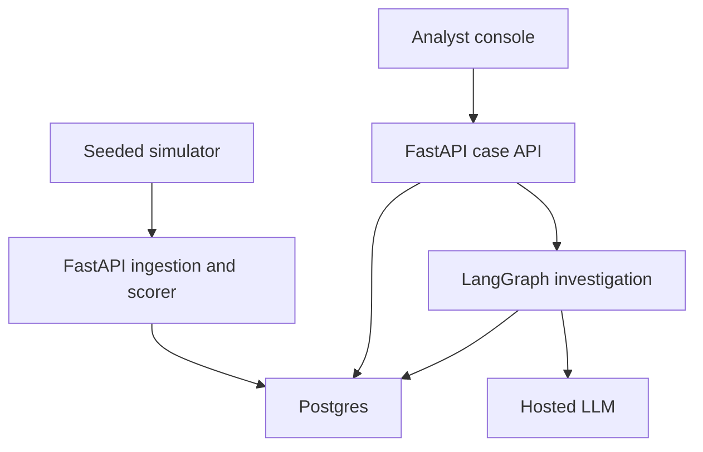

# Inquest implementation plan

Phase 0 proposal · 14 November 2026

Inquest replays synthetic card and UPI-style payment attempts. A small classifier scores each attempt and opens an analyst case at a fixed threshold. An analyst starts the investigation from the case. A bounded agent gathers cited evidence, recommends an action, and pauses for a decision. The API records the analyst's decision and resumes graph finalization. All actions are dispositions inside the demo. Inquest has no payment integration.

Start with the [data model](DATA_MODEL.md), [agent design](AGENT_DESIGN.md), [evaluation plan](EVAL_PLAN.md), and [design brief](DESIGN_BRIEF.md). Architecture choices and alternatives are tracked in the [decision log](DECISIONS.md).

## Architecture

The API owns ingestion, case state, and authorization. Postgres stores payment attempts, case and event history, decisions, and checkpoint state. The graph coordinates an allowlisted set of read-only tools through the API's repository layer. A local offline CLI trains the model, writes a versioned model and manifest, and runs evaluation. The serving image loads only the model artifact and inference dependencies. Use one API process and a bounded supervisor for simulator and investigation work. Persist cursors and run state so a process restart can recover work. Use the same API in Compose and on Render.

Compose starts Postgres, applies migrations, and starts the services available in each phase. The finished stack serves the console and a synthetic fixture on a single `docker compose up`. The local demo can replay recorded investigations when provider credentials are absent. Live investigations require a free-tier key supplied through environment configuration. CI will run lint, type checks, and tests, including real Postgres integration coverage. Structured logs include request, case and investigation IDs, status and duration. Keep secrets and raw provider payloads out of logs.

## Stack and verification

Package versions below are source snapshots and candidates for a compatibility lock. They are not install or runtime test results. Resolve the dependency set on Python 3.12 in the phase that introduces each dependency.

| Area | Proposal | Verified reference |
| --- | --- | --- |
| API | Python 3.12, FastAPI, Pydantic v2, typed service boundaries, SQLAlchemy and Alembic for application persistence and migrations | [FastAPI 0.162.7 on PyPI](https://pypi.org/project/fastapi/0.162.7/). First-party SSE has been available since 0.135.0. [FastAPI SSE docs](https://fastapi.tiangolo.com/tutorial/server-sent-events/) |
| Orchestration | LangGraph `StateGraph` and `AsyncPostgresSaver`. Use `interrupt()` and resume by thread ID with `Command(resume=...)`. | [LangGraph 1.2.21](https://pypi.org/project/langgraph/1.2.21/), [Postgres checkpointer 3.2.0](https://pypi.org/project/langgraph-checkpoint-postgres/3.2.0/), [interrupt API](https://docs.langchain.com/oss/python/langgraph/interrupts), [async saver setup](https://docs.langchain.com/oss/python/langgraph/add-memory) |
| Model | LightGBM with shallow trees, CPU inference, and native per-feature TreeSHAP contributions. Compare a simple linear baseline offline. | [LightGBM 4.7.0](https://pypi.org/project/lightgbm/4.7.0/), [Booster API](https://lightgbm.readthedocs.io/en/latest/pythonapi/lightgbm.Booster.html), [XGBoost 3.4.1](https://pypi.org/project/xgboost/3.4.1/), [XGBoost CPU packages](https://xgboost.readthedocs.io/en/stable/install.html), [SHAP 0.54.1](https://pypi.org/project/shap/0.54.1/) |
| Hosted LLM | Groq GPT-OSS 20B primary and Gemini 3.1 Flash-Lite as an explicitly selected alternative. Use each provider's official Python SDK behind a small adapter. | [Groq SDK 1.7.0](https://pypi.org/project/groq/1.7.0/), [Google Gen AI SDK 3.3.0](https://pypi.org/project/google-genai/3.3.0/), [Groq model](https://console.groq.com/docs/model/openai/gpt-oss-20b), [Gemini model](https://ai.google.dev/gemini-api/docs/models/gemini-3.1-flash-lite) |
| Web | Vite, React, TypeScript, Tailwind, TanStack Query, and Lucide. Static SPA with route rewrites and a browser-to-API event stream. | [Vite static deployment](https://vite.dev/guide/static-deploy), [Vercel SPA rewrites](https://vercel.com/docs/frameworks/frontend/vite) |
| Hosting | Vercel Hobby for the personal portfolio UI, one Render Free service, one Neon Free project. Compose uses local Postgres and the same app images. | [Vercel Hobby](https://vercel.com/docs/plans/hobby), [Render Free](https://render.com/docs/free), [Neon plans](https://neon.com/docs/introduction/plans) |

### Free-tier operating limits

| Service | Published allowance or account check | Design consequence |
| --- | --- | --- |
| Render Free | 512 MB RAM, 0.1 CPU, 750 free instance hours per workspace per month. Services idle after 15 minutes and the filesystem is ephemeral. [Instance limits](https://render.com/articles/from-side-project-to-production-scaling-your-first-app) · [Free services](https://render.com/docs/free) | One API worker, one active model investigation at first, measured peak memory during scoring and streaming. Use Postgres for durable state and local disk cache for disposable provider responses. |
| Neon Free | 1 GB storage, 100 CU-hours and 5 GB public transfer per project per month. Compute suspends after five idle minutes. [Neon plans](https://neon.com/docs/introduction/plans) · [Free plan FAQ](https://github.com/neondatabase/website/blob/main/content/faqs/free-plan-limits-and-quotas.md) | Use a small hosted fixture, bound event and checkpoint payloads, track `pg_total_relation_size`, and measure API and database cold starts together. Compact expired transient state according to documented retention. |
| Groq Free | GPT-OSS 20B listed at 30 requests/min, 1,000 requests/day, 8,000 tokens/min and 200,000 tokens/day. Effective limits are verified against the organization dashboard and response headers before benchmarking. [Groq rate limits](https://console.groq.com/docs/rate-limits) | Meter requests and tokens, apply bounded retry with jitter and `Retry-After`, and queue evaluation locally. At a 6,000-token cap, the published daily token limit covers at most 33 cases if each reaches the cap and the entire allowance is unused. |
| Gemini Free | Free input and output for Gemini 3.1 Flash-Lite are listed in the pricing catalog. Current numeric RPM, TPM, and RPD must be checked in the actual AI Studio project. No project quota was verified in Phase 0. [Gemini pricing](https://ai.google.dev/gemini-api/docs/pricing) · [Gemini rate limits](https://ai.google.dev/gemini-api/docs/rate-limits) | Keep Gemini optional until the project shows nonzero quota and passes a live structured-output smoke test. Use one provider and model per comparable evaluation run. |

Run a 512 MB cgroup smoke test before committing to the serving footprint. Measure cold and peak memory with the scorer loaded, an active simulator, and one active investigation. Aim for a peak under 400 MiB to leave headroom, with model loading, JSON serialization, and Postgres usage included. If the combined service misses that target, profile it first, trim dependencies and fixture size, and then compare the CPU-only XGBoost alternative under the same load. No deployment or provider call has been measured in this phase.

## API boundaries

| Endpoint | Contract |
| --- | --- |
| `GET /health`, `GET /ready` | Liveness and bounded readiness check for the database and loaded model |
| `GET /api/v1/cases`, `GET /api/v1/cases/{case_id}` | Cursor pagination with stable tie-breaker, filters, case version and latest investigation |
| `POST /api/v1/cases/{case_id}/investigations` | Idempotent start for an authorized analyst, returns a run ID |
| `GET /api/v1/investigations/{id}/events` | Reconnectable SSE with ordered IDs and typed event payloads |
| `POST /api/v1/investigations/{id}/decision` | Approve, override or escalate with an expected case version and idempotency key |
| `GET /api/v1/customers`, `GET /api/v1/customers/{id}/transactions` | Synthetic customer search and transaction timeline |
| `GET /api/v1/simulator`, `POST /api/v1/simulator/commands` | Simulator status and authorized start, pause and replay commands |
| `GET /api/v1/evaluations` | Recorded runs, denominators, configuration and comparison metrics |

Version the contract under `/api/v1`. Export and validate the OpenAPI schema as routes land, and pin the stream event schemas alongside it before frontend work. Proposed hosted access is a public read-only sample and an authenticated analyst workspace for edits and metered live calls. If public signup is required, design per-user workspace ownership and quota isolation in Phase 1. Use a short-lived authenticated fetch stream for restricted events and keep bearer tokens out of URLs. Both API calls and the event stream use the configured frontend origin.

## Proposed repository structure

| Path | Responsibility |
| --- | --- |
| `docs/` | Phase designs, decisions, dataset and evaluation reports, deployment and interview notes |
| `backend/app/api/`, `backend/app/db/`, `backend/migrations/` | Routes and schemas, persistence queries, Alembic revisions |
| `backend/app/simulator/`, `backend/app/scoring/` | Seeded generator, replay cursor, inference feature contract and model loader |
| `backend/app/investigation/` | Graph, tool registry, policy lookup, provider adapters, approval and events |
| `backend/evaluation/`, `backend/tests/` | Offline training and evaluation entry points, deterministic and integration tests |
| `frontend/src/` | React routes, API query client, event-stream client and shared UI components |
| `policies/`, `compose.yaml`, `.github/workflows/` | Synthetic policy corpus, local composition and CI |

## Phase gates and commit slices

Push each tested slice directly to `origin/main` in order. Stop at the end of each phase for review and approval. Changes across phases build on the previous phase's verified contract.

| Phase | Planned commit slices | Review gate |
| --- | --- | --- |
| 0 · Explore | Architecture and decisions, data and agent design, evaluation and UI brief | Agree on scope, stack and design before app code |
| 1 · Foundations | Compose and scaffold, migrations and repositories, generator and scenario tests, corpus and measured dataset report | One-command local startup and deterministic fixture |
| 2 · ML scoring | Point-in-time features, training and held-out report, serving artifact and API | Repeatable training, measured validation threshold, score and contribution parity |
| 3 · Agent tools and RAG | Read-only investigation tools, versioned policy retrieval | Stable evidence IDs, negative permissions and retrieval fixtures |
| 4 · Agent graph | Provider/cache and budgets, report verification and approval, reconnectable SSE | Interrupt survives restart, invalid evidence fails safely, authorized resume is idempotent |
| 5 · Evaluation | Dataset and harness, ablations and results, corrections with new run IDs | Paired held-out metrics and documented failure cases |
| 6 · Frontend | App shell and queue, case and SSE, explorer and simulator, evaluation and accessibility | End-to-end against the pinned contract on desktop and tablet |
| 7 · Hardening and deployment | CI and hardening, free-tier deployment checks, README demo and interview notes | Verified hosted flow, measured memory and reproducible local demo |

## Main risks

| Risk | Mitigation and when to check |
| --- | --- |
| Synthetic data leaks the answer | Separate generator truth, version features, use overlapping scenario signals and test on a seed plus scenario-parameter shift. Check in phases 1 and 2. |
| The agent appears strong because the ML gate filters difficult misses | Publish both alert-only and end-to-end denominators and use policy and tool ablations. Check in phase 5. |
| Provider rate or model availability changes | Meter and cap usage, fail into an explicit inconclusive result, and provide a clearly labeled recorded demo. Check in phases 4 and 7. |
| Restart or duplicate approvals lose progress | Durable checkpoints and ordered events, idempotency, row-level concurrency control and restart tests. Check in phase 4. |
| Public users consume quota or interfere with shared cases | Make the sample read-only. Authorize writes server-side and enforce workspace scope and live-run limits. Decide the signup model before schema work. |
| Combined free-tier cold start, storage and memory limits | Budget and measure each resource under the actual hosted workload before publishing. Keep bulk evaluation local. |

## Questions for Phase 1

1. Should the hosted portfolio have public signup with an isolated workspace per analyst, or a public read-only sample plus an invite-only analyst workspace?
2. Should the demo use India-first INR and Indian cities, or a geography-neutral fixture? Both options include card and UPI-style attempts.
3. Do you have a Groq project for the live demo, and should Gemini stay optional until its project quota is confirmed? Please share availability only. Credentials belong in the local environment.
4. Do you approve the slate-and-teal analyst console in [the design brief](DESIGN_BRIEF.md), including dark and light themes?
5. Is the proposed validation target of at least 90% recall within 30 alerts per 1,000 transactions a good starting point for the portfolio demo?
